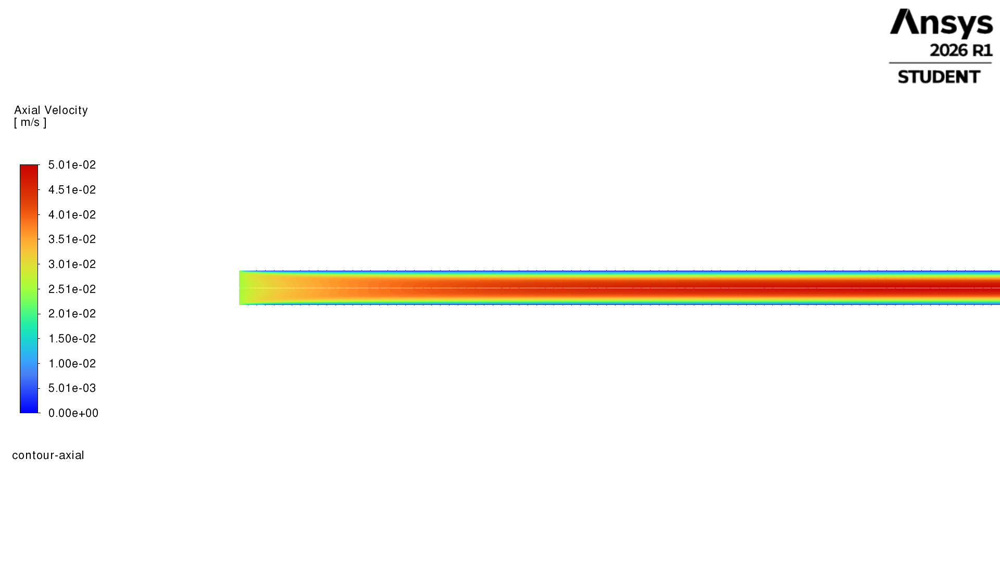
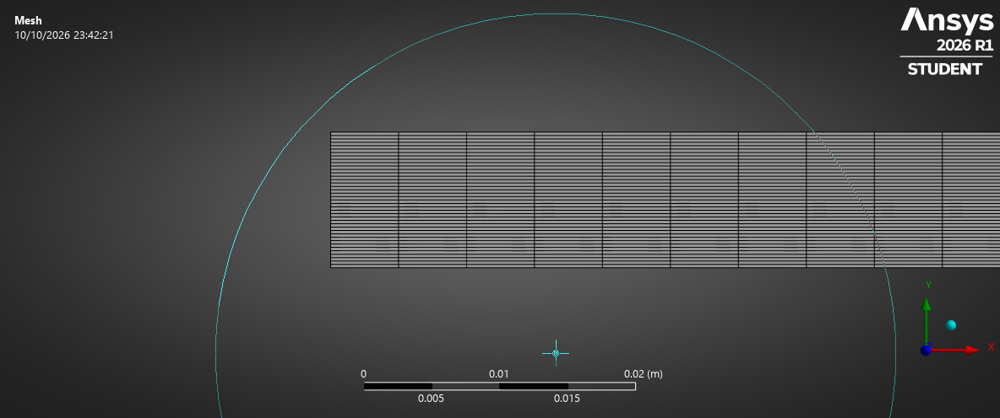
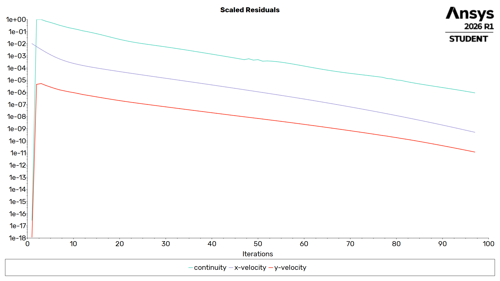
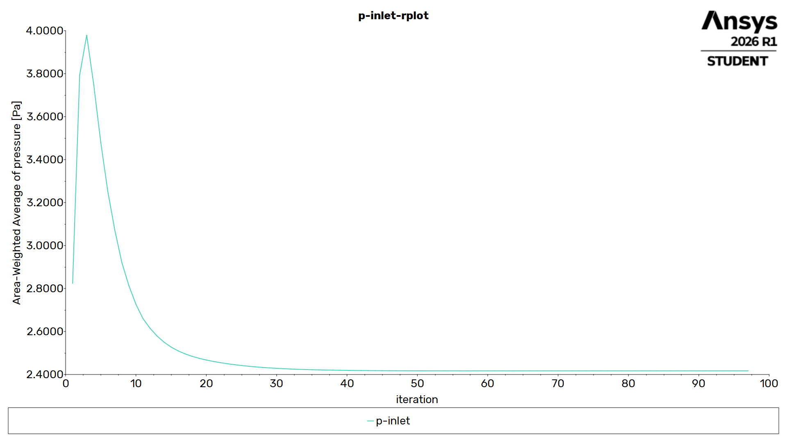
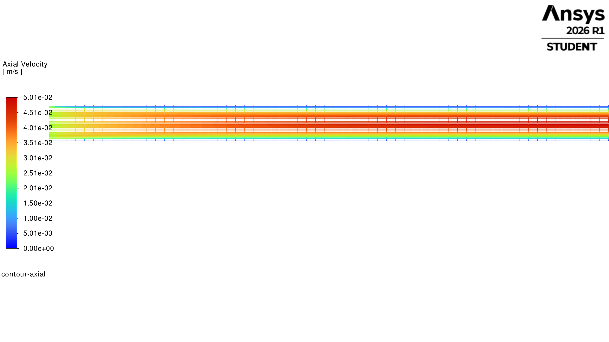
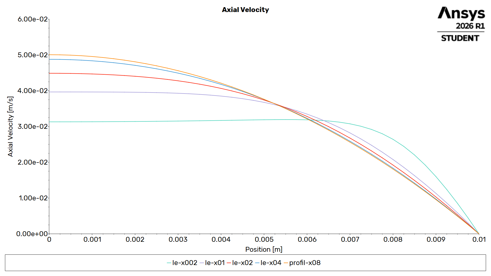
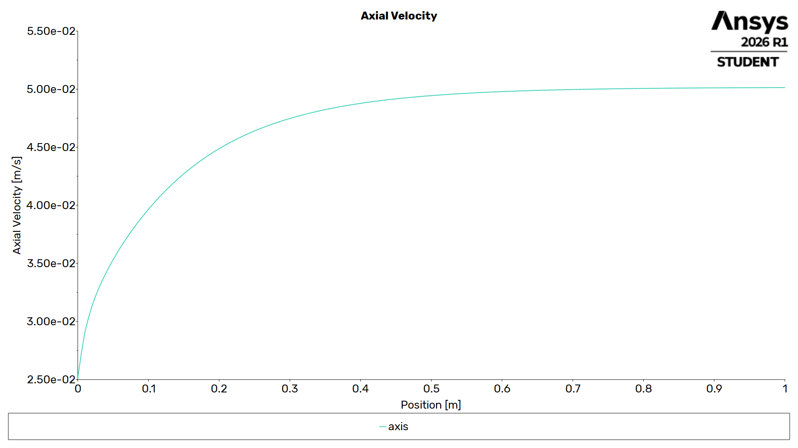
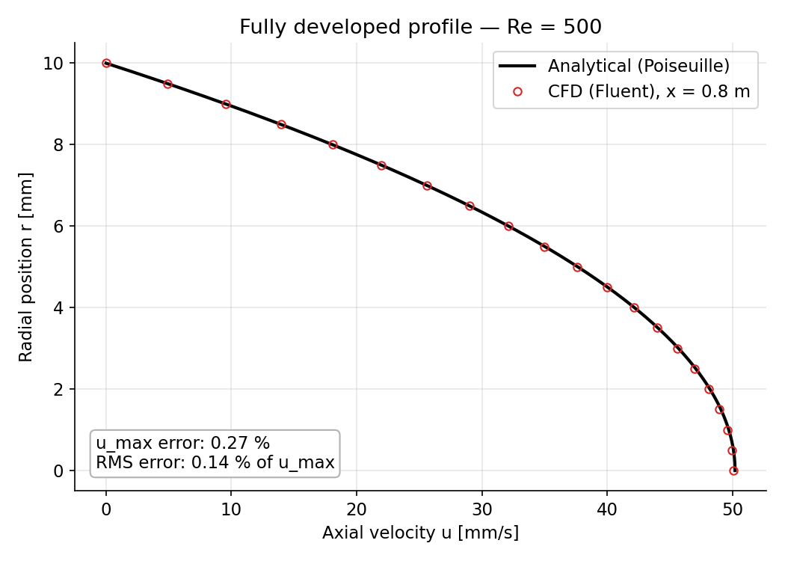
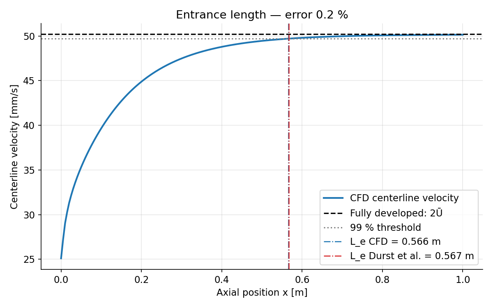

# Laminar Pipe Flow Validation — Hagen-Poiseuille (ANSYS Fluent)

CFD simulation of developing laminar flow in a circular pipe (Re ≈ 500) with ANSYS Fluent, validated against analytical and empirical references: **centerline velocity within 0.27 %, pressure drop within 1 %, entrance length within 0.7 %**.



---

## 1. Objective

Hagen-Poiseuille flow is one of the few viscous flows with an exact analytical solution. This makes it an ideal benchmark to validate a complete CFD workflow — geometry, meshing, solver setup, convergence assessment and post-processing — before moving on to cases without closed-form solutions (airfoil aerodynamics, compressible nozzle flow).

Three quantities are compared with reference values:
- the fully developed velocity profile and its maximum,
- the total pressure drop, including the entrance-region contribution,
- the hydrodynamic entrance length.

---

## 2. Problem Setup

| Parameter | Value |
|---|---|
| Pipe radius R / diameter D | 0.01 m / 0.02 m |
| Pipe length L | 1 m |
| Fluid | Liquid water — ρ = 998.2 kg/m³, μ = 1.003 × 10⁻³ Pa·s |
| Inlet condition | Uniform velocity, Ū = 0.0251 m/s |
| Reynolds number | Re = ρŪD/μ ≈ 500 (laminar) |

A uniform inlet profile is used on purpose: it lets the simulation capture the development of the boundary layer until the parabolic profile is established.

---

## 3. Analytical Reference

**Fully developed flow.** For steady, incompressible, laminar flow far from the inlet, the Navier-Stokes equations reduce to:

$$u(r) = 2\bar{U}\left(1 - \frac{r^2}{R^2}\right), \qquad \frac{dp}{dx} = -\frac{8\mu\bar{U}}{R^2}, \qquad f = \frac{64}{Re}$$

| Quantity | Theoretical value |
|---|---|
| Maximum (centerline) velocity u_max = 2Ū | 0.0502 m/s |
| Pressure gradient dp/dx | −2.01 Pa/m |
| Wall shear stress τ_w = 4μŪ/R | 0.0101 Pa |
| Darcy friction factor f | 0.128 |

**Entrance region.** Near the inlet, the flat profile progressively becomes parabolic. This costs an additional pressure drop, expressed with the Hagenbach coefficient (K ≈ 1.25 for laminar pipe flow):

$$\Delta p_{total} = \frac{8\mu\bar{U}}{R^2}L + K\,\frac{1}{2}\rho\bar{U}^2 = 2.01 + 0.39 \approx 2.40 \text{ Pa}$$

**Entrance length.** Defined as the distance where the centerline velocity reaches 99 % of its fully developed value. The textbook estimate L_e ≈ 0.05·Re·D gives 0.50 m; the more accurate correlation of Durst et al. (2005) gives:

$$\frac{L_e}{D} = \left[0.619^{1.6} + (0.0567\,Re)^{1.6}\right]^{1/1.6} \;\Rightarrow\; L_e \approx 0.567 \text{ m}$$

---

## 4. Numerical Model



| Setting | Choice |
|---|---|
| Domain | 2D axisymmetric (half cross-section, axis along x) |
| Mesh | Structured mapped mesh, 200 × 40 quadrilaterals (Δx = 5 mm, Δr = 0.25 mm), 8 000 cells |
| Solver | Pressure-based, steady, laminar, double precision |
| Pressure-velocity coupling | Coupled (pseudo-time) |
| Spatial discretization | Least-squares gradients, 2nd-order pressure, 2nd-order upwind momentum |
| Boundary conditions | Velocity inlet (0.0251 m/s), pressure outlet (0 Pa gauge), no-slip wall, axis |
| Convergence criteria | Scaled residuals < 10⁻⁶ + area-averaged inlet pressure monitor |

**Modelling choices**
- **Axisymmetry** reduces the problem to a 2D half-plane — about two orders of magnitude fewer cells than an equivalent 3D model, with no loss of accuracy since the flow has no azimuthal dependence.
- **Mapped quadrilaterals aligned with the flow** minimize numerical diffusion. Cells are refined radially, where velocity gradients are strongest, and stretched axially (aspect ratio 20), where gradients are weak.
- **Double precision** avoids round-off errors on pressure differences of only a few pascals.

The mesh check confirms the axisymmetric setup: the computed fluid volume equals πR²L = 3.1416 × 10⁻⁴ m³.

---

## 5. Convergence





The solution converged in about 100 iterations, with all residuals below 10⁻⁶. The area-averaged inlet pressure — a physical quantity, more meaningful than residuals alone — stabilizes at **≈ 2.40 Pa**.

---

## 6. Results

### 6.1 Flow development



The wall boundary layer grows from the inlet corner while the core accelerates to conserve the flow rate, until viscous effects reach the axis.



Velocity profiles at x = 0.02, 0.1, 0.2, 0.4 and 0.8 m show the transition from a nearly flat profile to the Poiseuille parabola. Two physical features are worth noting:

- **Profiles cross around r ≈ 5.5 mm.** Every cross-section carries the same flow rate: as the core accelerates, the near-wall region must slow down, so the profiles pivot around a common crossing zone.
- **Velocity overshoot at x = 0.02 m.** Close to the inlet, the velocity is slightly higher off-axis (r ≈ 5 mm) than on the centerline. This is a known feature of developing laminar flow with a uniform inlet profile, not a numerical artefact: fluid displaced by the growing boundary layer accelerates just outside it before the effect reaches the axis.

### 6.2 Centerline velocity



The centerline velocity rises from the inlet value (0.0251 m/s) and asymptotically approaches 2Ū ≈ 0.0502 m/s.

---

## 7. Validation

| Quantity | Reference | CFD | Error |
|---|---|---|---|
| u_max at x = 0.8 m | 0.0502 m/s (Poiseuille) | 0.05007 m/s | **0.27 %** |
| Total pressure drop | 2.40 Pa (Poiseuille + Hagenbach) | ≈ 2.40 Pa | **< 1 %** |
| Entrance length L_e (99 %) | 0.567 m (Durst et al., 2005) | 0.571 m | **0.7 %** |





**Entrance length measurement.** The centerline velocity was extracted on vertical lines at x = 0.4, 0.5, 0.6 and 0.7 m, and the 99 % threshold was located by linear interpolation:

| x (m) | u_axis (m/s) |
|---|---|
| 0.4 | 0.048803 |
| 0.5 | 0.049458 |
| 0.6 | 0.049796 |
| 0.7 | 0.049973 |

**Choice of reference value.** Using the outlet centerline velocity (0.05014 m/s) as the "fully developed" value gives L_e = 0.553 m (2.5 % error). However, the centerline velocity is still slightly increasing at the outlet, so this reference is biased low. Using the theoretical fully developed value (0.0502 m/s) — consistent with the definition used by Durst et al. — gives L_e = 0.571 m (0.7 % error). When a quantity approaches its limit asymptotically, comparing with a correlation requires using exactly the same definition.

---

## 8. Limitations & Next Steps

- **Domain length:** L ≈ 1.75 L_e is just sufficient; a 1.5 m pipe would ensure a fully developed region well upstream of the outlet.
- **Mesh independence:** not yet demonstrated. A study with 20 / 40 / 80 radial cells would quantify the discretization error.
- **Next cases:** NACA airfoil (k-ω SST turbulence, boundary-layer meshing, y⁺ control) and a converging-diverging nozzle (compressible flow, shock capturing).

---

## 9. Repository Structure

```
├── README.md
├── images/     Figures (mesh, convergence, contours, profiles, validation)
├── data/       Fluent XY exports (profil_x08.xy, vitesse_axe.xy, profils_developpement.xy)
└── scripts/    validation.py — CFD vs. theory comparison plots
```

## 10. References

- Durst F., Ray S., Ünsal B., Bayoumi O.A. (2005). *The Development Lengths of Laminar Pipe and Channel Flows*. Journal of Fluids Engineering, 127(6), 1154–1160.
- White F.M. *Fluid Mechanics*. McGraw-Hill — Hagen-Poiseuille flow and entrance effects.
- Shah R.K., London A.L. (1978). *Laminar Flow Forced Convection in Ducts*. Academic Press — entrance-region pressure drop.

## Tools

ANSYS Student 2026 R1 (SpaceClaim, Meshing, Fluent) · Python (NumPy, Matplotlib)

---

**Author:** Yanis Boutabia — Aerospace Engineering student (Aerospace Vehicles, Energy & Propulsion), IPSA Paris
